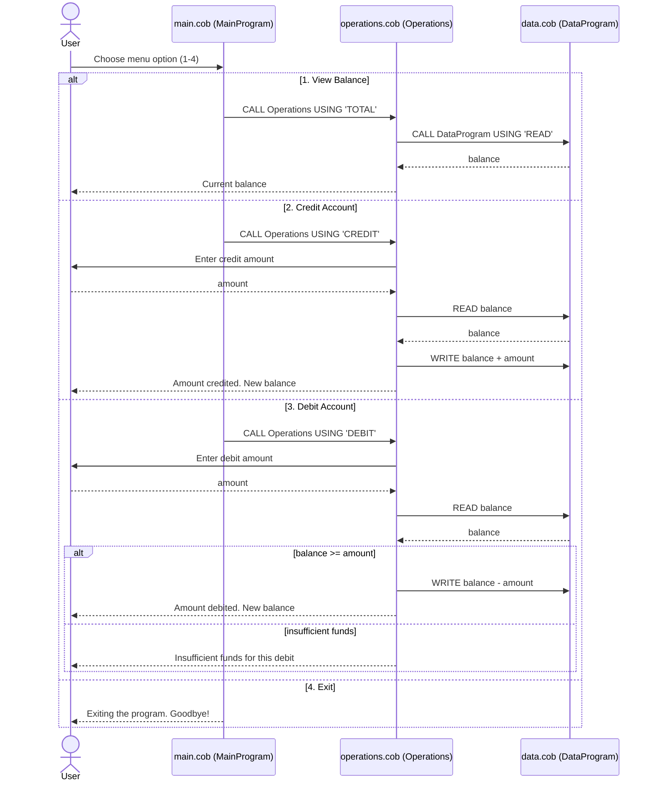

# Student Account Management System (COBOL)

This legacy COBOL application lets school staff manage a student account balance from the terminal: view the balance, credit (add funds) and debit (withdraw funds).

## Files

### `main.cob` - MainProgram

- Entry point of the application.
- Shows a menu in a loop until the user chooses **4. Exit**:
  1. View Balance
  2. Credit Account
  3. Debit Account
  4. Exit
- Reads the user's choice and calls `Operations` with `TOTAL`, `CREDIT` or `DEBIT`.
- Displays "Invalid choice, please select 1-4." for any other input.

### `operations.cob` - Operations

- Receives the operation type from `main.cob` and performs the business logic.
- `TOTAL`: reads the balance from `DataProgram` and displays it.
- `CREDIT`: asks for an amount, reads the balance, adds the amount, writes the new balance back and displays it.
- `DEBIT`: asks for an amount, reads the balance and, **only if the balance is greater than or equal to the amount**, subtracts it and writes it back. Otherwise it displays "Insufficient funds for this debit."

### `data.cob` - DataProgram

- Acts as the data/storage layer.
- Keeps the balance in `STORAGE-BALANCE` (initially **1000.00**).
- `READ` returns the stored balance to the caller; `WRITE` saves a new balance.

## Business rules for student accounts

- Every account starts with a balance of **1000.00**.
- Amounts use the format `PIC 9(6)V99` (up to 999,999.99, two decimal places, no negative values).
- A debit can never make the balance negative.
- The balance is only kept in memory for the lifetime of the program (no persistent storage).

## Data flow

